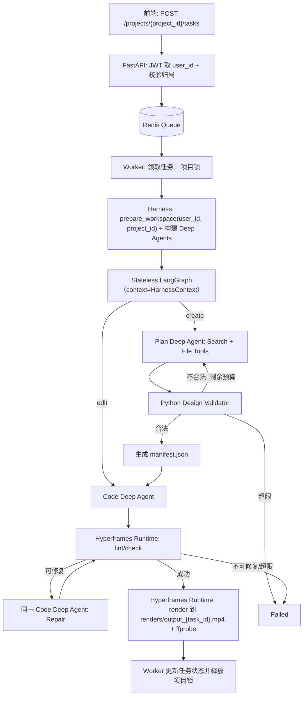

# FrameForge / HyperWeaver 后端架构与手动开发指南（Plan + Code 双 Deep Agents 版）

> 更新日期：2026-11-14  
> 适用范围：**后端**，不包含 React 前端实现。  
> 技术栈：Python 3.12+、FastAPI、LangChain、LangGraph、**Deep Agents**、Pydantic 2、SQLModel + aiomysql、MySQL 8、Redis、Hyperframes。  
> 设计基线：Plan Agent + Code Agent；固定工作流；**LangGraph 无持久化记忆**；Plan / Code 都使用 Deep Agents **内置文件工具**，不自行编写 read/write/edit/bash；固定 Runtime 控制视频检查与渲染；**工作区按 `workspaces/{user_id}/{project_id}/` 隔离，由 Harness 构建并通过 LangGraph `context` 注入外层图**。

## 0. 本次架构更新：Plan 与 Code 统一使用 Deep Agents

本方案以用户提供的上一版 Deep Agents 后端文档为基础，**仅改变 Plan Agent 的执行机制与设计产物协议，并保持其余后端结构**。

| 模块 | 上一版本 | 本版本 |
|---|---|---|
| Plan Agent | `with_structured_output(VideoDesign)` | **`create_deep_agent()`**；自主读取资料、创建/编辑 `design.md` |
| Code Agent | `create_deep_agent()` | 不变；Generate/Edit/Repair 复用同一类型 |
| 设计文件 | 强制模型输出 `design.json`，再派生 `design.md` | **`workspaces/{user_id}/{project_id}/design.md` 为单一真源**；后端解析必需元数据生成同目录下的 `manifest.json` |
| 检索 | 暂无 | V1 Plan 可接已有搜索工具；V2 选装 Research Subagent |
| Shell | 无 | **不等于网页搜索**；若确需 `execute`，只使用独立隔离沙箱，不能使用 Web Worker 的宿主 Shell |
| Harness | Deep Agents File Backend、Skills、权限、事件 | **Harness 同时负责构建 `workspaces/{user_id}/{project_id}/` 工作区**；Plan 和 Code 分别配置文件权限 |
| 工作区 | `workspaces/project_X/tasks/task_Y/working/` + `revisions/` | **`workspaces/{user_id}/{project_id}/` 按用户+项目严格隔离**（`design.md`、`manifest.json`、`video/`、`renders/`、`logs/` 全部保存在该目录下）；V2 再加 `revisions/` |
| LangGraph | Plan → Code → Validate → Repair → Render | 加入确定性的 **Design Validate → Plan Repair**，仍然无 Checkpointer；**图启动时只编译一次**，工作区与 Agent 经 `context=HarnessContext` 注入 |
| MySQL | 4 表 | 不变：`users/projects/messages/tasks`；表由 `sql/schema.sql` 手动创建，应用不建表、不迁移 |
| Render | 固定 Hyperframes Runtime | 不变；Agent 无正式渲染能力 |

**核心原则**：Agent 通过工具**写入真实文件**，但“文件已写入”不等于“设计有效”。`design.md` 必须包含机器可识别的场景标签及单场景时长；由可信 Python 校验、提取元数据，并按错误让 Plan Agent **定向修改文件**。这不是要求模型一次性生成完整 JSON Schema。

### 0.1 架构边界

- **外层 LangGraph** 只执行当前视频任务的固定阶段，不承担跨轮记忆。
- **Plan Deep Agent** 负责构思、检索、设计、编辑设计文档；**只有它**可以写当前项目工作区下的 `workspaces/{user_id}/{project_id}/design.md`（Agent 内部虚拟路径为 `/workspace/design.md`）。
- **Code Deep Agent** 负责编辑当前项目工作区下的 `workspaces/{user_id}/{project_id}/video/**`（Agent 内部虚拟路径为 `/workspace/video/**`），默认只读同目录下的 `design.md`。
- **Research Agent（后期）** 作为 Plan 的 `task` 子代理，仅返回已核实的检索摘要和来源 URL，不直接写 `design.md`，不在外层 Graph 新增节点。
- **Hyperframes Runtime** 独立执行 lint/check/snapshot/render；任何 Agent 的 Shell 权限都不能代替外层渲染路径。
- **Agent Harness**（`app/agent/harness/`）读取 `config.yaml` 中 `agent.workspace_dir` 与 `agent.skills_dir`，负责构建 `workspaces/{user_id}/{project_id}/`、装配本任务专用的 Plan / Code Deep Agents，并打包成只读的 `HarnessContext` 交给外层图。
- **Task / Project Services** 管理 MySQL、Redis 中的业务状态；Graph/Deep Agents 不配置长期 Checkpointer。

**注意**：因为每个用户会有多个项目和任务，所有 Agent 执行产物（`design.md`、`manifest.json`、`video/**`、`renders/**`、`logs/**`）**必须全部保存在 `workspaces/{user_id}/{project_id}/` 下实现多项目隔离**。Deep Agents 内部的 `/workspace/` 只是单次任务挂载到当前 `workspaces/{user_id}/{project_id}/` 的虚拟前缀（`StateBackend()` 的虚拟内存文件不会自动落盘，必须显式将 `/workspace/` 绑定到该项目的物理目录）。

### 0.2 本次优化：用户 / 项目工作区 + Harness 注入

1. **全产物按用户+项目目录隔离**：每个 Agent 的物理工作目录统一为 `workspaces/{user_id}/{project_id}/`（根目录与 Skills 目录均在 `config.yaml` 的 `agent:` 下配置），`design.md`、`manifest.json`、`video/`、`renders/`、`logs/` 全部保存在该目录下；路径中的 ID 只来自 JWT 与数据库，绝不接受客户端传入路径。
2. **V1 请求协议精简**：前端先 `POST /api/v1/projects` 创建项目拿到 `project_id`，再 `POST /api/v1/projects/{project_id}/tasks` 提交需求（仅含 `prompt` 及默认视频参数 `duration_seconds`、`resolution`；不设默认风格样式，受众固定面向计算机学习者并直接写入 Agent 系统提示词）；`user_id` 一律取自 JWT。
3. **Harness 构建工作区**：Worker 调用 `build_harness_context(...)`，在 Harness 内完成 `prepare_workspace(user_id, project_id)` → 构建 Deep Agents（将虚拟 `/workspace/` 路由到 `workspaces/{user_id}/{project_id}/`）→ 返回 `HarnessContext`。
4. **注入外层图**：外层 `StateGraph(VideoState, context_schema=HarnessContext)` 在启动时编译一次，每个任务以 `video_graph.ainvoke(state, context=ctx)` 运行；节点通过 `runtime.context` 访问工作区与 Agent，`VideoState` 只保存可变的流程数据。
5. **KISS**：按 `GEMINI.md`，原 `PlanAgent` / `CodeAgent` / `VideoNodes` / `WorkspaceService` / `HyperframesRuntime` / `RedisEventService` 类均改为普通异步函数。

### 0.3 本版的检索路线

V1：给 Plan Agent 一个**已有搜索服务的工具适配**（例如 `TavilyClient`/模型提供商内置搜索），检索返回文本并带来源；不必使用 Bash。V2：当主题复杂、搜索次数多时，利用 Deep Agents `subagents=[...]` 增加 Research Agent，主 Plan 只拿精炼摘要，搜索过程在子 Agent 上下文完成。

`execute` 在 Deep Agents 中仅对支持命令执行协议的后端可用。`LocalShellBackend` 在宿主机直接执行任意 Shell，官方明确不适用于多用户生产服务；即便配置了虚拟根，也**不能限制 Shell 访问路径**。如果为了在沙箱执行 `curl`，必须额外约束网络出站、DNS/SSRF、资源上限、进程权限与禁用内部服务访问；这仍然不如专用搜索 API 对检索任务适配良好。

## 1. V1 目标与工作流

### 1.1 V1 交付

1. 前端先创建项目，再提交 `project_id` + 需求（`prompt` 及默认视频参数 `duration_seconds`、`resolution`）；后端从 JWT 取 `user_id`、校验项目归属后创建异步任务。
2. Worker 调用 Harness 构建 `workspaces/{user_id}/{project_id}/` 与本任务的 Deep Agents（虚拟 `/workspace/` 绑定到该项目目录）；Plan Deep Agent 根据需求按需搜索/读 Skills，自主创建 `workspaces/{user_id}/{project_id}/design.md`（虚拟路径 `/workspace/design.md`），包含**教学设计、画面布局、动作时间线、场景标识与时长**。
3. `validate_design` 在 Agent 之外解析、校验该项目目录下的 `design.md`；失败则再次调用**同一个 Plan Deep Agent** 通过 `edit_file` 修改设计文档，重试次数受限。
4. 校验通过后，可信 Python 在该项目目录下生成 `manifest.json` 初版；此文件不由 Agent 任意写入。
5. Code Deep Agent 读取同目录下的 `design.md` + Hyperframes Skills，只写该项目下的视频工程源码 `workspaces/{user_id}/{project_id}/video/**`（虚拟路径 `/workspace/video/**`）。
6. Hyperframes Runtime 检查源码，Code Deep Agent 有限次 Repair；通过后由 Runtime 正式渲染到 `workspaces/{user_id}/{project_id}/renders/output_{task_id}.mp4`、`ffprobe` 验证 MP4。
7. Worker 更新 MySQL 任务状态，Redis Streams 推送阶段事件。
8. V2 可根据用户截图、时间戳、版本信息继续调用 Code Deep Agent 编辑已有工程，并引入 `revisions/` 快照。

### 1.2 流程图



### 1.3 不做的事情

不实现动态 Supervisor、不使用 Deep Agents 长期 memory/store、不让 Research 直接修改 Plan 文件、不将 HTML/MP4/大量工具日志存入 MySQL、不让 Deep Agent 自行正式检查或渲染、不新增数据库表。

## 2. 为什么 Plan、Code 都采用 `create_deep_agent`

`create_deep_agent` 返回 LangGraph 编译图，可以在外层 LangGraph 节点内调用 `.ainvoke()`。两种 Agent 共享基础 Harness，但**文件权限、提示词、工具、执行预算各自独立**。

| 能力 | Plan Agent | Code Agent |
|---|---|---|
| 文件浏览 `ls/glob/grep/read_file` | 允许：`/skills/**`、`/workspace/**`（即 `workspaces/{user_id}/{project_id}/**`） | 允许：`/skills/**`、`/workspace/**`（即 `workspaces/{user_id}/{project_id}/**`） |
| 文件写入 `write_file/edit_file` | 仅 `/workspace/design.md`（物理落盘到 `workspaces/{user_id}/{project_id}/design.md`） | 仅 `/workspace/video/**`（物理落盘到 `workspaces/{user_id}/{project_id}/video/**`） |
| 联网搜索 | V1 可使用已有专用 Search Tool | 默认不开放 |
| Deep Agents 内置 `task` | V1 禁用，V2 Research Subagent | 禁用 |
| Shell `execute` | 默认禁用；独立沙箱可选 | 默认禁用 |
| Video Render | **禁止** | **禁止** |
| `design.md` 真源 | 写入/编辑 | 只读 |
| `manifest.json` | 不写；程序生成 | 不写；程序更新 |
| 长期对话持久化 | Graph 外 ContextService | Graph 外 ContextService |

Deep Agents 的内置文件工具与 `skills=[...]` 能力已经由框架提供，不需要为 Plan 单独实现 read/write/edit。推荐在 V1 先验证 **Plan 写 Markdown + Code 写工程** 这条链路，再考虑 Search Subagent。

对于“结构化输出不稳定”：改为文件工具并不保证模型总能输出正确格式。因此我们只把**无法省略的机器接口**（`scene_id`、`duration_seconds` 等）写成少量固定格式，其余设计说明保持自由 Markdown。内容质量由 Prompt 和人工验收，格式可靠性由 Python Validator 和 Agent 文件修复循环保证。

## 3. 依赖安装与目录

### 3.1 Python 依赖

```bash
cd backend
# 已有依赖：fastapi[standard]、sqlmodel、aiomysql、redis、pyjwt、pwdlib[argon2]、
#           pyyaml、python-dotenv、langchain、langchain-openai、langgraph
uv add deepagents tavily-python arq
uv lock
```

选择固定的 `deepagents` 版本并提交 `uv.lock`。`FilesystemMiddleware(tools=...)`、Profile、Permissions 是需要版本匹配的 API；**本方案针对 2026 年 11 月在线文档的 API**。正式实施以锁文件、`python -c` 导入验证和官方版本参考为准。

安装并锁定 Hyperframes CLI 与 FFmpeg（具体 Node/npm 安装操作以锁定版本为准）：

```bash
node --version
ffmpeg -version
ffprobe -version
npx hyperframes lint --help
npx hyperframes check --help
npx hyperframes snapshot --help
npx hyperframes render --help
```

### 3.2 建议文件组织

```text
backend/
├── app/
│   ├── main.py
│   ├── config/
│   │   ├── config.py                   # 纯配置读取（YAML + .env 占位符）
│   │   └── config.yaml
│   ├── core/
│   │   ├── exceptions.py
│   │   └── security.py
│   ├── middleware/
│   │   └── jwt_auth.py
│   ├── db/
│   │   ├── base.py
│   │   ├── mysql.py                    # 只加载连接，不建表、不迁移
│   │   └── redis.py
│   ├── api/
│   │   ├── deps.py
│   │   └── v1/
│   │       ├── health.py
│   │       ├── auth.py
│   │       ├── projects.py             # 项目 CRUD + 提交任务 + 设计/视频读取
│   │       ├── tasks.py                # 任务状态、SSE、取消
│   │       └── messages.py             # V2 激活
│   ├── models/
│   │   ├── user.py
│   │   ├── project.py
│   │   ├── message.py
│   │   └── task.py
│   ├── schemas/
│   │   ├── auth.py
│   │   ├── project.py
│   │   └── task.py                     # CreateTaskRequest
│   ├── services/
│   │   ├── auth.py
│   │   ├── project.py
│   │   ├── task.py                     # 创建任务、Worker 执行入口 execute_task
│   │   ├── events.py                   # publish_event（Redis Streams）
│   │   └── context.py                  # V2：多轮历史摘要
│   ├── agent/
│   │   ├── state.py                    # VideoState + HarnessContext
│   │   ├── graph.py                    # 启动时编译一次 video_graph
│   │   ├── nodes.py                    # 纯函数节点，经 runtime.context 取依赖
│   │   ├── plan.py                     # run_plan / repair_plan
│   │   ├── code.py                     # generate_code / repair_code / edit_code
│   │   ├── design_validator.py
│   │   ├── search.py                   # Tavily 适配：非文件工具
│   │   ├── prompts/
│   │   │   ├── plan.md
│   │   │   └── code.md
│   │   └── harness/
│   │       ├── workspace.py            # 重点：构建 workspaces/{user_id}/{project_id}/
│   │       └── factory.py              # 重点：Deep Agents 配置 + build_harness_context
│   ├── runtime/
│   │   ├── process.py
│   │   └── hyperframes.py
│   └── worker.py
├── skills/                             # 经人工审核的 Hyperframes SKILL.md（只读）
├── workspaces/                         # {user_id}/{project_id}/，不提交 Git
├── sql/
│   └── schema.sql                      # 手动执行的建表 DDL
├── tests/
├── pyproject.toml
└── uv.lock
```

**删掉旧方案的 `agent/tools/read.py`、`write.py`、`edit.py`、`bash.py`、`harness/runtime.py` 中手工文件工具实现、自制 Skill Loader，以及 `services/workspace.py`（工作区改由 `agent/harness/workspace.py` 构建）。** `harness/` 只保留两件事：构建工作区、把 Deep Agents 能力正确配置给本次任务。

### 3.3 配置扩展（`config.yaml` + `.env`）

沿用现有配置约定：非敏感配置写入 `app/config/config.yaml`，敏感值只放 `.env` 并以 `${VAR}` 占位，代码通过 `get_settings()` 读取，不使用 `os.environ`。**`workspaces` 与 `skills` 的存放目录统一配置在 `agent:` 下**：

```yaml
#===============================Agent 与模型配置=========================
agent:
  # 相对 backend/ 解析；每个项目的物理工作目录为 {workspace_dir}/{user_id}/{project_id}/
  workspace_dir: ./workspaces
  skills_dir: ./app/agent/skills
  # 对应 langchain_openai.ChatOpenAI 核心初始化参数（已有）
  llm:
    model: ""
    base_url: ""
    api_key: ${OPENAI_API_KEY}
    temperature: 0.7
    max_tokens: 8192
    timeout: 120.0
    max_retries: 2
  search:
    # Tavily Key 请在 .env 中配置 TAVILY_API_KEY
    api_key: ${TAVILY_API_KEY}
  recursion_limit: 80
  design_max_repairs: 2
  code_max_repairs: 3

#===============================Hyperframes Runtime======================
runtime:
  hyperframes_bin: /absolute/path/to/preinstalled/hyperframes
  ffprobe_bin: ffprobe
  lint_timeout: 120
  check_timeout: 240
  render_timeout: 900
```

`.env` 只新增一行 `TAVILY_API_KEY=`；`config.py` 的 `AgentConfig` 直接新增 `workspace_dir`、`skills_dir` 等字段，另增 `SearchConfig`、`RuntimeConfig` 两个 Pydantic 模型。

---

## 4. 输入协议、设计文件契约与临时 State

### 4.1 API 请求协议（V1）

V1 前端分两步：先 `POST /api/v1/projects` 创建项目得到 `project_id`，再向 `POST /api/v1/projects/{project_id}/tasks` 提交需求。`project_id` 走路径参数，`user_id` 只从 JWT（`request.state.user_id`）获取，请求体中**不出现** `user_id` 或任何路径字段。

**参数边界**：
- **视频技术参数**（`duration_seconds`、`resolution`）提供合理默认值，前端可不传或按需覆盖；
- **不设默认风格/样式**（不在 Schema 中硬编码“白色、冰川绿”等预设风格），视觉风格由用户在 `prompt` 中按需描述，或由 Agent 根据知识点与 Skills 自主设计；
- **不包含 `audience` 字段**：本项目本身专注于计算机科学学习（数据结构与算法、操作系统、计算机网络、分布式系统等）的动画知识点讲解视频，目标受众与教学定位直接固化在 Agent 的系统提示词（`prompts/plan.md` 与 `prompts/code.md`）中。

用户的任务输入仍然用 Pydantic 做**请求参数校验**；这并不等于让 LLM 输出结构化 JSON。

```python
# app/schemas/task.py
from typing import Literal

from pydantic import BaseModel, Field


class CreateTaskRequest(BaseModel):
    """提交视频生成任务的请求体（project_id 由路径参数提供）。"""

    prompt: str = Field(min_length=5, max_length=5000)
    duration_seconds: int = Field(default=120, ge=15, le=600)
    resolution: Literal["1280x720", "1920x1080"] = "1920x1080"
```

API 层处理顺序：

1. `CurrentIdentityDep` 取得 `user_id`；
2. 查询 `projects.id == project_id AND projects.user_id == user_id`，不存在返回 `404`（不暴露他人项目是否存在）；
3. 同一项目已有 `pending/running` 任务返回 `409`；
4. 事务内写入 `messages`（用户需求）与 `tasks(status='pending')`，提交后投递 Redis，返回 `202` 和 `task_id`。

V1 中 `CreateTaskRequest` 序列化后保存到 `messages.metadata`，Worker 据此还原需求；工作区路径**不入库**，每次都由 `user_id + project_id` 推导。

### 4.2 `design.md` 唯一真源（保存在 `workspaces/{user_id}/{project_id}/design.md`）

每个项目的分镜设计文档都保存在各自独立的工作区 `workspaces/{user_id}/{project_id}/design.md` 下，不同用户、同一用户的不同项目互不覆盖。建议 Plan Agent 必须采用如下**轻量、可解析的场景标题与时长标记**，设计文本不需要严格 JSON：

```markdown
# 二叉搜索树插入动画

## 全局设计
- 知识点定位：二叉搜索树（BST）的性质与节点插入查找过程
- 视觉与排版：由 Agent 根据知识点与用户需求自主规划配色、组件布局与字体层级
- 总目标时长：90 秒
- 统一规范：分镜间自然过渡，动画与讲解同步

## Scene scene_01: 背景与概念
- duration_seconds: 12
- learning_goal: 明确什么是二叉搜索树
- narration: 二叉搜索树遵循左小右大的性质……
- layout: 中央显示根节点，左右区域留出子树空间
- animation:
  - 0s–2s 显示标题
  - 2s–6s 创建根节点 8
  - 6s–12s 依次展示左右子节点和连线
- transition: 节点树缩小并滑入下一场景

## Scene scene_02: 插入搜索路径
- duration_seconds: 78
- learning_goal: 演示插入节点的比较与移动
- narration: ……
- layout: ……
- animation: ……
- transition: 淡入回顾页面
```

**唯一必须机器解析的字段**为 `Scene scene_XX` 标记与 `duration_seconds`；内容完整性通过检查 `learning_goal/narration/layout/animation/transition` 文本存在来约束，其他视觉描述自由扩展。禁止在正文中再写形如 `## Scene ...` 的无关演示，以免被识别为真实分镜。

### 4.3 外层 Graph 的 State 与 Context

外层图把数据分成两类：

| 类别 | 载体 | 内容 | 特点 |
|---|---|---|---|
| 只读运行依赖 | `HarnessContext`（`context_schema`） | `user_id`、`project_id`、`task_id`、`mode`、需求、`workspace`、Plan/Code Agent | 由 Harness 构建，整个任务内不可变，节点无法篡改工作区路径 |
| 可变流程数据 | `VideoState`（`state_schema`） | 错误列表、重试次数、渲染路径、最终状态 | 节点之间传递，随 `ainvoke` 结束丢弃 |

```python
# app/agent/state.py
from dataclasses import dataclass
from pathlib import Path
from typing import Literal, TypedDict

from langgraph.graph.state import CompiledStateGraph

from app.schemas.task import CreateTaskRequest


@dataclass(frozen=True)
class HarnessContext:
    """单次任务的只读运行上下文，由 Harness 构建后经 ainvoke(context=...) 注入外层图。"""

    user_id: int
    project_id: int
    task_id: int
    mode: Literal["create", "edit"]
    request: CreateTaskRequest
    # workspaces/{user_id}/{project_id}/ 的物理绝对路径，Deep Agents 的 /workspace/ 也映射到这里
    workspace: Path
    plan_agent: CompiledStateGraph
    code_agent: CompiledStateGraph


class VideoState(TypedDict, total=False):
    """外层图的可变流程状态，不包含路径、Agent 等运行依赖。"""

    design_errors: list[str]
    design_repair_count: int
    validation_errors: list[str]
    error_kind: str
    repair_count: int
    render_path: str
    status: Literal["running", "success", "failed", "cancelled"]
    error: str
```

外层 Graph `compile()` **不配置 Checkpointer**，因此 `HarnessContext` 中携带不可序列化的 Agent 对象没有问题。内部 Deep Agent 使用自己的本次短时消息 State，不存到数据库；Plan/Code 之间通过工作区真实文件交付，不共享模型对话消息。

**为什么不把 `workspace` 放进 State**：State 是节点可写的，放进去等于允许任意节点改路径；而且 Agent 构造时就需要工作区（Backend `root_dir`），两处来源容易不一致。放在 Context 里，图只需在启动时编译一次，每个任务换一个 Context 即可。

## 5. Plan Agent：`create_deep_agent`，直接创建/编辑 `design.md`

### 5.1 为什么这样做

从用户需求生成完善的视频计划通常要多轮内部动作：阅读已有规范、查询专业资料、设计分镜、写文件、再次检查并调整。`with_structured_output` 适合简短、固定字段的响应，但复杂课程与长分镜容易产生不完整的镜头说明。这里改用 Deep Agent 的文件工作流，允许多次修改 `design.md`，最终由确定性 Validator 进行格式与时长检查。

> 这不是“取消所有结构约束”：少量可解析标记仍然是 Code Agent、进度展示、场景时间轴所需的最小协议。模型正文可以完全自由，不必生成庞大 JSON。

### 5.2 Web Search：不必为了搜索开放 Bash

官方 Deep Agents Quickstart 使用 `TavilyClient.search()` 包装工具，也支持部分模型提供商的内置 Web Search。若使用 OpenAI 兼容模型服务但无法确定支持原生搜索，推荐使用下面的简单适配（唯一自写的是**第三方搜索 API 适配器**，并非 read/write/edit 工具）。

```python
# app/agent/search.py
from functools import cache

from tavily import TavilyClient

from app.config.config import get_settings


@cache
def _client() -> TavilyClient:
    """延迟创建 Tavily 客户端，避免导入模块时就要求配置已加载。"""
    return TavilyClient(api_key=get_settings().agent.search.api_key)


def internet_search(query: str, max_results: int = 5) -> dict:
    """搜索公开网页，返回摘要、来源标题和链接。"""
    return _client().search(
        query,
        max_results=max(1, min(max_results, 8)),
        include_raw_content=False,
        topic="general",
    )
```

联网服务通常有配额和延迟；对可信的基础概念不必搜索，遇到知识点不确定、需要示例或权威资料时再检索。搜索文本不可信，不能覆盖系统指令；Plan Prompt 需要求核实出处并避免凭空引用。

### 5.3 Plan Deep Agent 构造

Plan 与 Code 共用 Harness 构建的同一个项目工作区 `workspaces/{user_id}/{project_id}/`（挂载为 Agent 内部的 `/workspace/`），但是 **Plan 仅允许修改 `/workspace/design.md`（即物理路径 `workspaces/{user_id}/{project_id}/design.md`），Code 仅允许修改 `/workspace/video/**`（即物理路径 `workspaces/{user_id}/{project_id}/video/**`）**。Agent 的构建见第 6.4 节；这里只是两个普通异步函数，直接从 `HarnessContext` 取 Agent 与工作区，不再包一层类。

```python
# app/agent/plan.py
from app.agent.harness.factory import invoke_agent
from app.agent.state import HarnessContext


async def run_plan(ctx: HarnessContext) -> None:
    """调用 Plan Deep Agent 在当前项目工作区创建 workspaces/{user_id}/{project_id}/design.md。

    Raises:
        FileNotFoundError: Agent 运行结束但项目工作区中没有 design.md。
    """
    request = ctx.request
    await invoke_agent(
        ctx.plan_agent,
        f"用户需求：{request.prompt}\n"
        f"目标时长：{request.duration_seconds} 秒；分辨率：{request.resolution}。\n"
        "请先按需查阅 Skills、对不确定的计算机知识点进行网页检索，"
        "再调用 write_file 创建 /workspace/design.md。"
        "严格采用 ## Scene scene_01: 标题 与 - duration_seconds: N 格式。"
        "每个场景需有学习目标、旁白、布局、动画时间线和转场。"
        "不要编写 Hyperframes HTML/JS，不要触发检查或渲染。",
    )
    if not (ctx.workspace / "design.md").is_file():
        raise FileNotFoundError("Plan Agent 未创建 design.md")


async def repair_plan(ctx: HarnessContext, errors: list[str]) -> None:
    """让 Plan Deep Agent 按校验错误定向修改 design.md。"""
    await invoke_agent(
        ctx.plan_agent,
        "请使用 read_file 检查 /workspace/design.md，"
        "并使用 edit_file 或 write_file 定向修复下列校验问题。"
        "保持原有设计的教学意图和镜头连续性。\n"
        + "\n".join(f"- {message}" for message in errors[:20]),
    )
```

**注意**：每次调用使用新的 Deep Agent 对话 State，但 `workspaces/{user_id}/{project_id}/design.md` 保留在真实磁盘中。Plan Repair 不依赖之前的 Chat History，也无需 Checkpointer。

### 5.4 设计 Validator：真实可运行的 Python 代码

```python
# app/agent/design_validator.py
import json
import re
from pathlib import Path

SCENE_HEADING = re.compile(
    r"^## Scene (scene_\d+):\s*(.+?)\s*$",
    re.MULTILINE,
)
DURATION = re.compile(r"(?m)^- duration_seconds:\s*(\d+(?:\.\d+)?)\s*$")
REQUIRED = ("learning_goal", "narration", "layout", "animation", "transition")


def validate_design(path: Path, expected_seconds: int) -> list[dict]:
    text = path.read_text(encoding="utf-8")
    matches = list(SCENE_HEADING.finditer(text))
    if not matches:
        raise ValueError("没有找到 ## Scene scene_01: 标题 格式的分镜")

    scenes = []
    for i, match in enumerate(matches):
        scene_id, title = match.group(1), match.group(2).strip()
        end = matches[i + 1].start() if i + 1 < len(matches) else len(text)
        section = text[match.end():end]
        duration_matches = DURATION.findall(section)
        if len(duration_matches) != 1:
            raise ValueError(f"{scene_id} 必须且只能有一个 duration_seconds")
        duration = float(duration_matches[0])
        if not (0 < duration <= expected_seconds):
            raise ValueError(f"{scene_id} 时长无效：{duration}")
        for field in REQUIRED:
            # animation 可以是多行列表，其他字段要求同一行有文字。
            pattern = (
                r"(?m)^- animation:\s*(?:\S.*|\n\s+-\s+\S.*)"
                if field == "animation"
                else rf"(?m)^- {field}:\s*\S"
            )
            if not re.search(pattern, section):
                raise ValueError(f"{scene_id} 缺少 {field} 字段")
        scenes.append({"scene_id": scene_id, "title": title, "duration_seconds": duration})

    ids = [item["scene_id"] for item in scenes]
    if len(set(ids)) != len(ids):
        raise ValueError("场景 scene_id 不唯一")
    if abs(sum(x["duration_seconds"] for x in scenes) - expected_seconds) > 3:
        raise ValueError("场景总时长与用户目标相差超过 3 秒")
    return scenes


def write_manifest(scenes: list[dict], output: Path) -> None:
    current_ms = 0
    result = []
    for item in scenes:
        duration_ms = round(item["duration_seconds"] * 1000)
        result.append({
            "scene_id": item["scene_id"],
            "title": item["title"],
            "start_ms": current_ms,
            "end_ms": current_ms + duration_ms,
            "source_files": [],
        })
        current_ms += duration_ms
    output.write_text(
        json.dumps({"schema_version": 1, "duration_ms": current_ms, "scenes": result},
                   ensure_ascii=False, indent=2),
        encoding="utf-8",
    )
```

这只校验了最低限度的可机械验证项，不检查教学知识真伪、旁白语速或动画视觉质量；后者仍需专业 Prompt 与视频验收。`manifest` 的 `source_files` 初始为空，Code 后可由确定性文件扫描/项目约定补齐，并在发布前核实真实镜头边界。

### 5.5 设计重试逻辑

在外层 Graph 增加 `validate_design` 节点：

- 创建模式：`run_plan → validate_design`。
- 不合法且 `design_repair_count < agent.design_max_repairs`（默认 2）：`repair_plan(errors) → validate_design`。
- 合法：调用 `write_manifest`，进入 Code。
- 超过预算：返回失败（而不是把不完整设计交给 Code）。

设计重试只修改文件；不会重启整个外层视频工作流、不会修改 MySQL 的历史消息。

### 5.6 V2：Research Agent 作为 Plan 的子 Agent

只在检索复杂度明显增加时接入：

```python
research_subagent = {
    "name": "research-agent",
    "description": "核实计算机课程知识点，检索权威资料并返回简明摘要及来源 URL",
    "system_prompt": (
        "你是计算机课程资料研究员。只负责检索、核查知识点、汇总证据。"
        "返回简要结论、必要定义和可检查的来源 URL。"
        "不要修改 design.md，不要写视频代码，不要输出 research.md。"
    ),
    "tools": [internet_search],
    # 防止 Research 继承 Plan 的 design.md 写权限
    "permissions": [
        FilesystemPermission(operations=["write"], paths=["/**"], mode="deny")
    ],
}

# V2 为 Plan 调用 create_deep_agent 时传入：
# subagents=[research_subagent]
# 并将 Plan 的 tools 改为 []，使联网搜索只由 Research 子代理负责。
```

`task` 是 Deep Agents 内置的子 Agent 委派工具。由 Plan 决定是否委派（固定工作流顺序不变）。不要因 V1 的全局工具排除配置把 `task` 永久关闭，否则 V2 Research 无法接入。正式启用时，为 Research 另设**只读文件权限**；仅靠提示词“不要修改”不是安全隔离。

## 6. Code Agent：Deep Agents 内置文件操作 + 双 Agent Factory

### 6.1 工具及路径

- Plan、Code 使用内置 `ls/read_file/write_file/edit_file/glob/grep`；不手动实现文件工具。
- 两个 Agent 的 `/workspace/` 都映射到 Harness 构建的 `workspaces/{user_id}/{project_id}/`，Agent 看不到真实绝对路径，也看不到其他用户/项目。
- Plan 独占 `/workspace/design.md` 的写入，Code 独占 `/workspace/video/**` 的写入。
- `/skills/**` 对两者只读；`manifest.json`、`renders/**`、`logs/**` 对两者只读（由程序与 Runtime 写入）。
- `/scratch/**` 可用于 Agent 临时文本存储，采用 StateBackend，本次调用完即丢弃。
- Plan 初版可以通过 `internet_search` 查询外部资料；Code 不开放 Search，以保持职责清晰。
- Shell `execute` 默认不开放；V1 先不需要 Bash。以后若引入独立 Sandboxed Backend，可给 Plan 配 `execute`，但**不能由 Prompt 假装 Shell 已隔离**。

### 6.2 Backend 路由（虚拟路径 → 按用户+项目隔离的物理路径）

因为一个用户可能同时拥有多个项目与多次任务，**所有 Agent 执行产物（包括 `design.md`、`manifest.json`、`video/**`、`renders/**`、`logs/**`）都必须保存在各自独立的 `workspaces/{user_id}/{project_id}/` 目录下**。Deep Agents 工具看到的 `/workspace/` 只是单次任务挂载到当前项目目录的虚拟根目录：

```text
/workspace/design.md      → {agent.workspace_dir}/{user_id}/{project_id}/design.md        （仅 Plan 可写）
/workspace/video/**       → {agent.workspace_dir}/{user_id}/{project_id}/video/**         （仅 Code 可写）
/workspace/manifest.json  → {agent.workspace_dir}/{user_id}/{project_id}/manifest.json    （只读，程序生成）
/workspace/renders/**     → {agent.workspace_dir}/{user_id}/{project_id}/renders/**       （只读，Runtime 写）
/workspace/logs/**        → {agent.workspace_dir}/{user_id}/{project_id}/logs/**          （只读，Runtime 写）
/skills/**                → {agent.skills_dir}/**（只读）
/scratch/**               → StateBackend（不跨调用）
```

### 6.3 Harness 构建工作区

工作区由 Harness 构建，而不是 API 层或 Service 层：只有 Harness 知道 Deep Agents 的 `/workspace/` 要映射到哪里，把“建目录”和“建 Backend”放在一起，路径来源只有一处，且根目录直接读取 `config.yaml` 中 `agent.workspace_dir`。

```python
# app/agent/harness/workspace.py
from pathlib import Path

from app.config.config import get_settings

BACKEND_DIR = Path(__file__).resolve().parents[3]
WORKSPACE_SUBDIRS = ("video", "renders", "logs")


def get_workspace_path(user_id: int, project_id: int) -> Path:
    """推导 workspaces/{user_id}/{project_id}/ 的物理绝对路径（不创建目录）。

    API 读取 design.md / MP4 时也复用此函数，保证与 Agent 使用同一路径规则。

    Raises:
        ValueError: ID 不是正整数，或解析后的路径逃逸出工作区根目录。
    """
    if user_id <= 0 or project_id <= 0:
        raise ValueError("user_id 与 project_id 必须为正整数")
    root = (BACKEND_DIR / get_settings().agent.workspace_dir).resolve()
    workspace = (root / str(user_id) / str(project_id)).resolve()
    # ID 虽然只来自 JWT 与数据库，仍做越界兜底，防止符号链接等导致逃逸
    if not workspace.is_relative_to(root):
        raise ValueError(f"工作区路径越界：{workspace}")
    return workspace


def prepare_workspace(user_id: int, project_id: int) -> Path:
    """创建（或复用）任务工作区及固定子目录，返回其物理绝对路径。"""
    workspace = get_workspace_path(user_id, project_id)
    for name in WORKSPACE_SUBDIRS:
        (workspace / name).mkdir(parents=True, exist_ok=True)
    return workspace
```

要点：

- **只接受整数 ID**：`user_id` 来自 JWT，`project_id` 已在 API 层校验归属，Worker 再从数据库读出；客户端永远不能提交路径。
- **V1 原地模式**：同一项目再次提交任务时复用同一目录，`design.md` / `video/` 会被覆盖更新，历次 MP4 以 `renders/output_{task_id}.mp4` 保留。V2 再在此目录下增加 `revisions/`。
- **不在此处清理旧文件**：是否保留历史 MP4、何时清理，属于项目删除/配额策略，不放进 Harness。

### 6.4 Plan / Code Factory 与 `build_harness_context`

下面使用官方 `FilesystemPermission`、`FilesystemMiddleware`、`CompositeBackend`。**只注册不包含 `excluded_tools={"task"}` 的通用 Profile**，确保未来 Research 子 Agent 可以出现 `task`。指定的 File Backend 不支持 `execute`，因此不会凭空暴露 Shell。

`build_harness_context` 是 Harness 的唯一入口：Worker 只调用它，拿到 `HarnessContext` 后直接交给外层图。

```python
# app/agent/harness/factory.py
from pathlib import Path
from typing import Literal

from deepagents import (
    FilesystemPermission,
    GeneralPurposeSubagentProfile,
    HarnessProfile,
    create_deep_agent,
    register_harness_profile,
)
from deepagents.backends import CompositeBackend, FilesystemBackend, StateBackend
from deepagents.middleware.filesystem import FilesystemMiddleware
from langchain_core.language_models import BaseChatModel
from langchain_core.messages import HumanMessage
from langchain_openai import ChatOpenAI
from langgraph.graph.state import CompiledStateGraph

from app.agent.harness.workspace import BACKEND_DIR, prepare_workspace
from app.agent.search import internet_search
from app.agent.state import HarnessContext
from app.config.config import get_settings
from app.schemas.task import CreateTaskRequest

PROMPTS_DIR = Path(__file__).resolve().parents[1] / "prompts"
FILE_TOOLS = ["ls", "read_file", "write_file", "edit_file", "glob", "grep"]

_profile_registered = False


def _register_profiles() -> None:
    """进程内只注册一次 Harness Profile，关闭默认通用子 Agent。"""
    global _profile_registered
    if _profile_registered:
        return
    register_harness_profile(
        "openai",
        HarnessProfile(
            general_purpose_subagent=GeneralPurposeSubagentProfile(enabled=False),
        ),
    )
    _profile_registered = True


def _make_backend(workspace: Path, skills_root: Path) -> CompositeBackend:
    """把 /workspace/ 映射到本任务工作区，/skills/ 映射到只读 Skills 目录。"""
    return CompositeBackend(
        default=StateBackend(),
        routes={
            "/workspace/": FilesystemBackend(root_dir=workspace, virtual_mode=True),
            "/skills/": FilesystemBackend(root_dir=skills_root, virtual_mode=True),
        },
    )


def _build_agent(
    model: BaseChatModel,
    workspace: Path,
    prompt_name: str,
    permissions: list[FilesystemPermission],
    tools: list,
    subagents: list,
) -> CompiledStateGraph:
    """按给定权限构建一个绑定到本任务工作区的 Deep Agent。"""
    _register_profiles()
    skills_root = (BACKEND_DIR / get_settings().agent.skills_dir).resolve(strict=True)
    backend = _make_backend(workspace, skills_root)
    return create_deep_agent(
        model=model,
        system_prompt=(PROMPTS_DIR / prompt_name).read_text(encoding="utf-8"),
        backend=backend,
        # 自定义 FilesystemMiddleware 必须同时绑定 permissions，否则会出现工具层权限缺口
        middleware=[
            FilesystemMiddleware(backend=backend, permissions=permissions, tools=FILE_TOOLS)
        ],
        skills=["/skills/"],
        permissions=permissions,
        tools=tools,
        subagents=subagents,
        checkpointer=None,
    )


def build_plan_agent(
    model: BaseChatModel, workspace: Path, research_subagent: dict | None = None
) -> CompiledStateGraph:
    """构建 Plan Deep Agent：只能写 /workspace/design.md 与 /scratch/。"""
    permissions = [
        FilesystemPermission(operations=["write"], paths=["/workspace/design.md"], mode="allow"),
        FilesystemPermission(operations=["write"], paths=["/scratch/**"], mode="allow"),
        FilesystemPermission(operations=["write"], paths=["/**"], mode="deny"),
    ]
    if research_subagent is None:
        return _build_agent(model, workspace, "plan.md", permissions, [internet_search], [])
    return _build_agent(model, workspace, "plan.md", permissions, [], [research_subagent])


def build_code_agent(model: BaseChatModel, workspace: Path) -> CompiledStateGraph:
    """构建 Code Deep Agent：只能写 /workspace/video/** 与 /scratch/。"""
    permissions = [
        FilesystemPermission(
            operations=["write"],
            paths=[
                "/workspace/design.md",
                "/workspace/manifest.json",
                "/workspace/renders/**",
                "/workspace/logs/**",
            ],
            mode="deny",
        ),
        FilesystemPermission(operations=["write"], paths=["/workspace/video/**"], mode="allow"),
        FilesystemPermission(operations=["write"], paths=["/scratch/**"], mode="allow"),
        FilesystemPermission(operations=["write"], paths=["/**"], mode="deny"),
    ]
    return _build_agent(model, workspace, "code.md", permissions, [], [])


def build_harness_context(
    user_id: int,
    project_id: int,
    task_id: int,
    mode: Literal["create", "edit"],
    request: CreateTaskRequest,
) -> HarnessContext:
    """Harness 入口：构建工作区与本任务专用的 Plan / Code Deep Agents。

    Returns:
        可直接传给 video_graph.ainvoke(context=...) 的只读运行上下文。
    """
    llm = get_settings().agent.llm
    model = ChatOpenAI(
        model=llm.model,
        base_url=llm.base_url or None,
        api_key=llm.api_key,
        temperature=llm.temperature,
        max_tokens=llm.max_tokens,
        timeout=llm.timeout,
        max_retries=llm.max_retries,
    )
    workspace = prepare_workspace(user_id, project_id)
    return HarnessContext(
        user_id=user_id,
        project_id=project_id,
        task_id=task_id,
        mode=mode,
        request=request,
        workspace=workspace,
        plan_agent=build_plan_agent(model, workspace),
        code_agent=build_code_agent(model, workspace),
    )


async def invoke_agent(agent: CompiledStateGraph, instruction: str) -> None:
    """以全新的消息 State 运行一次 Deep Agent（不复用历史对话）。"""
    await agent.ainvoke(
        {"messages": [HumanMessage(content=instruction)]},
        config={"recursion_limit": get_settings().agent.recursion_limit},
    )
```

**务必在自定义 FilesystemMiddleware 同时传入 `permissions`**：自定义中间件可能替换 Deep Agents 默认实例；如果只传 `tools` 而没有绑定权限，会形成工具层权限缺口。

**实际落地时要核对 `deepagents` 版本 API**（尤其 Harness Profiles 和 Middleware 覆盖顺序）。上面 `_register_profiles` 针对模型 provider `openai`，如果模型是其他 provider，需要对应注册。另应区分模型是否使用兼容协议和实际 provider 注册键。

> 文件权限本身**不是操作系统沙箱**。对于可访问服务端 `.env` 的进程，尤其不能以 `FilesystemBackend` 的虚拟目录保护密钥。生产必须以独立 Agent 沙箱/容器的最小文件挂载和系统权限为边界。Research 子代理如启用，应继承/设置只读权限，不得继承 Plan 的 design.md 写权限。

### 6.5 Code Agent：Generate / Edit / Repair 共用

```python
# app/agent/code.py
from app.agent.harness.factory import invoke_agent
from app.agent.state import HarnessContext


async def generate_code(ctx: HarnessContext) -> None:
    """根据 design.md 在 /workspace/video/ 生成完整 Hyperframes 工程。"""
    await invoke_agent(
        ctx.code_agent,
        "请读取 /workspace/design.md 与相关 /skills/ 下的 SKILL.md，"
        "在 /workspace/video/ 创建全部 Hyperframes 工程源码，保持场景 ID。"
        "不要运行正式检查或渲染。",
    )


async def repair_code(ctx: HarnessContext, errors: list[str]) -> None:
    """按 Runtime 诊断最小化修复已有源码。"""
    await invoke_agent(
        ctx.code_agent,
        "读取已有源码并最小化修复以下诊断；禁止自主检查和渲染：\n" + "\n".join(errors[:20]),
    )


async def edit_code(ctx: HarnessContext, scene_id: str | None = None) -> None:
    """按用户的修改需求只调整必要的现有源码（V2 多轮编辑）。"""
    target = f"目标场景：{scene_id}。" if scene_id else ""
    await invoke_agent(ctx.code_agent, target + "仅修改必要的现有源码：" + ctx.request.prompt)
```

**同一个 Code Agent 支持生成、修复、编辑**；每次新的消息 State，代码只保存在 `workspaces/{user_id}/{project_id}/video/`。真实成功由后续 Runtime 检查决定。

### 6.6 Shell 与检索的区别

- V1 搜索：Plan 的专用检索工具；无需 Shell。
- V2 检索：Plan `task` → Research Subagent，返回摘要，不单独写 `research.md`。
- 如果以后 Plan 需要执行命令，只有在 Backend 支持沙箱命令协议时才会出现 `execute`。可选隔离容器必须不挂载数据库凭据，不可访问内部服务；禁止在主机使用 `LocalShellBackend` 作为多用户服务执行器。
- Code Agent 不具备执行渲染命令的权限。形式上的禁止与实际沙箱能力是两回事；禁止 Agent 任意 Shell 是 V1 最容易验证的保证方式。

## 7. 无持久化 LangGraph：设计修复与代码修复分离

### 7.1 两层执行

- 外层 `StateGraph`：Plan、validate_design、repair_design、Code、Validate、Repair、Render、Success/Failed。
- 内层 Plan / Code Deep Agents：各自具备工具调用循环，但不绑定 Checkpointer；不共享 messages/files/todos 状态 schema。
- `HarnessContext` 由 Harness 在图外构建，经 `ainvoke(context=...)` 注入；节点只通过 `runtime.context` 访问工作区和 Agent，绝不自行拼接路径。

### 7.2 Graph Nodes：真实代码

节点全部是普通异步函数，签名为 `(state, runtime: Runtime[HarnessContext])`，不再用 `VideoNodes` 类在构造时绑定依赖。

```python
# app/agent/nodes.py
from langgraph.runtime import Runtime

from app.agent.code import edit_code, generate_code, repair_code
from app.agent.design_validator import validate_design, write_manifest
from app.agent.plan import repair_plan, run_plan
from app.agent.state import HarnessContext, VideoState
from app.runtime.hyperframes import render_video, validate_video


async def plan(state: VideoState, runtime: Runtime[HarnessContext]) -> VideoState:
    """创建模式：生成 design.md。"""
    await run_plan(runtime.context)
    return {"design_repair_count": 0}


async def check_design(state: VideoState, runtime: Runtime[HarnessContext]) -> VideoState:
    """校验 design.md，通过后由程序生成 manifest.json。"""
    ctx = runtime.context
    try:
        scenes = validate_design(ctx.workspace / "design.md", ctx.request.duration_seconds)
        write_manifest(scenes, ctx.workspace / "manifest.json")
    except (OSError, ValueError) as exc:
        return {"design_errors": [str(exc)]}
    return {"design_errors": []}


async def repair_design(state: VideoState, runtime: Runtime[HarnessContext]) -> VideoState:
    """让 Plan Agent 按校验错误修改 design.md。"""
    await repair_plan(runtime.context, state.get("design_errors", []))
    return {"design_repair_count": state.get("design_repair_count", 0) + 1}


async def code(state: VideoState, runtime: Runtime[HarnessContext]) -> VideoState:
    """创建模式生成工程，编辑模式修改已有工程。"""
    ctx = runtime.context
    if ctx.mode == "create":
        await generate_code(ctx)
    else:
        await edit_code(ctx)
    return {"validation_errors": [], "repair_count": 0}


async def check_code(state: VideoState, runtime: Runtime[HarnessContext]) -> VideoState:
    """调用 Hyperframes lint/check 校验 video/ 工程。"""
    result = await validate_video(runtime.context.workspace)
    if result.ok:
        return {"validation_errors": [], "error_kind": "none"}
    return {"validation_errors": result.errors, "error_kind": result.kind}


async def repair(state: VideoState, runtime: Runtime[HarnessContext]) -> VideoState:
    """让 Code Agent 按诊断修复源码。"""
    await repair_code(runtime.context, state.get("validation_errors", []))
    return {"repair_count": state.get("repair_count", 0) + 1}


async def render(state: VideoState, runtime: Runtime[HarnessContext]) -> VideoState:
    """正式渲染到 renders/output_{task_id}.mp4。"""
    ctx = runtime.context
    path = await render_video(ctx.workspace, ctx.task_id)
    return {"render_path": str(path)}


async def succeeded(state: VideoState) -> VideoState:
    return {"status": "success"}


async def failed(state: VideoState) -> VideoState:
    problems = state.get("design_errors") or state.get("validation_errors") or []
    return {"status": "failed", "error": "；".join(problems)[-2000:] or "任务失败"}
```

`validate_video()` / `render_video()` 的具体实现见第 8 节；`render` 的环境性失败可作为异常交给 Worker 标记失败，不应盲目让 Code 修改源码。`edit` 模式从 START 直接进入 `code`，不经过设计校验。

### 7.3 Graph 组装：启动时编译一次

```python
# app/agent/graph.py
from langgraph.graph import END, START, StateGraph
from langgraph.graph.state import CompiledStateGraph
from langgraph.runtime import Runtime

from app.agent import nodes
from app.agent.state import HarnessContext, VideoState
from app.config.config import get_settings


def _route_start(state: VideoState, runtime: Runtime[HarnessContext]) -> str:
    return "plan" if runtime.context.mode == "create" else "code"


def _after_design(state: VideoState) -> str:
    if not state.get("design_errors"):
        return "code"
    if state.get("design_repair_count", 0) < get_settings().agent.design_max_repairs:
        return "repair_design"
    return "failed"


def _after_code_check(state: VideoState) -> str:
    if not state.get("validation_errors"):
        return "render"
    can_repair = state.get("repair_count", 0) < get_settings().agent.code_max_repairs
    if state.get("error_kind") == "code" and can_repair:
        return "repair"
    return "failed"


def build_video_graph() -> CompiledStateGraph:
    """组装外层视频工作流；不配置 Checkpointer，依赖经 context_schema 注入。"""
    graph = StateGraph(VideoState, context_schema=HarnessContext)
    graph.add_node("plan", nodes.plan)
    graph.add_node("validate_design", nodes.check_design)
    graph.add_node("repair_design", nodes.repair_design)
    graph.add_node("code", nodes.code)
    graph.add_node("validate", nodes.check_code)
    graph.add_node("repair", nodes.repair)
    graph.add_node("render", nodes.render)
    graph.add_node("succeeded", nodes.succeeded)
    graph.add_node("failed", nodes.failed)

    graph.add_conditional_edges(START, _route_start, {"plan": "plan", "code": "code"})
    graph.add_edge("plan", "validate_design")
    graph.add_conditional_edges(
        "validate_design",
        _after_design,
        {"code": "code", "repair_design": "repair_design", "failed": "failed"},
    )
    graph.add_edge("repair_design", "validate_design")
    graph.add_edge("code", "validate")
    graph.add_conditional_edges(
        "validate",
        _after_code_check,
        {"render": "render", "repair": "repair", "failed": "failed"},
    )
    graph.add_edge("repair", "validate")
    graph.add_edge("render", "succeeded")
    graph.add_edge("succeeded", END)
    graph.add_edge("failed", END)
    return graph.compile()


# 图结构与任务无关，进程内只编译一次；每个任务通过 context 注入不同的工作区与 Agent
video_graph = build_video_graph()
```

已用 LangGraph 1.2.22 验证：节点函数与条件路由函数都可以声明 `runtime: Runtime[HarnessContext]` 参数并读取 `runtime.context`。

### 7.4 Harness → Graph 的装配关系

不再需要 `create_video_workflow` 每个任务重新 `compile`。职责划分：

| 层 | 负责 | 入口 |
|---|---|---|
| API | 鉴权、校验项目归属、写任务、投递队列 | `POST /api/v1/projects/{project_id}/tasks` |
| Worker | 领取任务、项目锁、调用 Harness、运行图、更新状态 | `execute_task(task_id)` |
| Harness | 构建 `workspaces/{user_id}/{project_id}/`、构建 Deep Agents、打包 `HarnessContext` | `build_harness_context(...)` |
| Graph | 固定阶段流转与有限重试 | `video_graph.ainvoke(state, context=ctx)` |
| Runtime | lint / check / render / ffprobe | `validate_video` / `render_video` / `probe_mp4` |

Runtime 函数只接收 `workspace` 路径，不在调用前强制 `video/index.html` 已存在；缺文件时返回可修复诊断，交给 Repair，而不是阻止图运行。

### 7.5 运行示例

```python
# Worker 内部（execute_task 的核心片段）
from app.agent.graph import video_graph
from app.agent.harness.factory import build_harness_context

ctx = build_harness_context(
    user_id=project.user_id,      # 来自数据库，而非客户端
    project_id=project.id,
    task_id=task.id,
    mode="create",
    request=CreateTaskRequest.model_validate(message.metadata_),
)
result = await video_graph.ainvoke({"status": "running"}, context=ctx)
if result.get("status") != "success":
    raise RuntimeError(result.get("error", "视频生成失败"))
print(result["render_path"])      # .../workspaces/7/42/renders/output_301.mp4
```

**无持久化 State 不影响文件保存**：Deep Agents 通过绑定 `/workspace/` 的真实文件 Backend 写入 `workspaces/{user_id}/{project_id}/`，Plan 与 Code 的模型消息可在各次调用中重新开始；外层任务状态由 Worker/MySQL 负责。

## 8. Hyperframes Runtime：必须继续自己实现

这是 Deep Agents 无法替代的模块：文件工具可以创建源文件，**但其“完成”报告无法证明视频能被编译或渲染**。`lint`、`check`、`snapshot`、`render` 必须由 Python 以固定可控的进程调用。

### 8.1 子进程运行器（真实代码）

```python
# app/runtime/process.py
import asyncio
import os
import signal
from dataclasses import dataclass
from pathlib import Path


@dataclass(frozen=True)
class ProcessResult:
    returncode: int
    stdout: str
    stderr: str


async def run_process(
    argv: list[str],
    cwd: Path,
    timeout_seconds: int,
) -> ProcessResult:
    process = await asyncio.create_subprocess_exec(
        *argv,
        cwd=str(cwd),
        stdout=asyncio.subprocess.PIPE,
        stderr=asyncio.subprocess.PIPE,
        start_new_session=True,
    )
    try:
        async with asyncio.timeout(timeout_seconds):
            stdout, stderr = await process.communicate()
    except (TimeoutError, asyncio.CancelledError):
        try:
            os.killpg(process.pid, signal.SIGKILL)
        except ProcessLookupError:
            pass
        await process.communicate()
        raise
    return ProcessResult(
        returncode=process.returncode,
        stdout=stdout.decode("utf-8", errors="replace"),
        stderr=stderr.decode("utf-8", errors="replace"),
    )
```

这是 Linux/macOS 的进程组清理实现；生产需要增加 stdout/stderr 大小限制和内存配额，避免子进程输出过多。若渲染容器内部含 Chrome/FFmpeg，推荐由容器运行时提供 CPU/RAM/PID/超时隔离。

### 8.2 Runtime 适配器（真实代码）

Runtime 只接收 Harness 构建的 `workspace` 路径，在 `workspace/video/` 内执行 CLI，产物写到 `workspace/renders/`，完整日志写到 `workspace/logs/`。

```python
# app/runtime/hyperframes.py
from dataclasses import dataclass
from pathlib import Path

from app.config.config import get_settings
from app.runtime.process import run_process


@dataclass(frozen=True)
class ValidationResult:
    ok: bool
    kind: str
    errors: list[str]


async def validate_video(workspace: Path) -> ValidationResult:
    """在 workspace/video/ 中依次执行 hyperframes lint 与 check。"""
    cfg = get_settings().runtime
    video_dir = workspace / "video"
    if not (video_dir / "index.html").is_file():
        return ValidationResult(False, "code", ["缺少 video/index.html"])

    for command, timeout in (("lint", cfg.lint_timeout), ("check", cfg.check_timeout)):
        result = await run_process([cfg.hyperframes_bin, command], video_dir, timeout)
        if result.returncode != 0:
            error_text = (result.stderr + "\n" + result.stdout).strip()
            return ValidationResult(
                False,
                "code",
                [f"{command} 执行失败（退出码 {result.returncode}）：{error_text[-8000:]}"],
            )
    return ValidationResult(True, "none", [])


async def render_video(workspace: Path, task_id: int) -> Path:
    """正式渲染到 workspace/renders/output_{task_id}.mp4，并记录渲染日志。

    Raises:
        RuntimeError: 渲染命令失败或没有生成有效 MP4。
    """
    cfg = get_settings().runtime
    output = workspace / "renders" / f"output_{task_id}.mp4"
    result = await run_process(
        [cfg.hyperframes_bin, "render", "--output", str(output)],
        workspace / "video",
        cfg.render_timeout,
    )
    log_path = workspace / "logs" / f"task_{task_id}.log"
    log_path.write_text(result.stdout + "\n" + result.stderr, encoding="utf-8")
    if result.returncode != 0:
        raise RuntimeError((result.stderr or result.stdout)[-8000:])
    if not output.is_file() or output.stat().st_size == 0:
        raise RuntimeError("渲染命令没有生成有效的 MP4 文件")
    return output
```

注意：

1. `runtime.hyperframes_bin` 要指向你在 Worker/容器中预安装的**实际可执行文件**。不建议在任务中让 `npx` 联网下载未经锁定的新版本。
2. CLI 目前官方给出 `hyperframes lint`、`check`、`snapshot --at`、`render --output`；不同版本可能支持 `--json` 等标志。**先用本机锁定版本 `--help` 测试，不复制不确定的参数**。
3. 代码中的 CLI 非零退出暂按 `code` 错误交 Repair，但生产**必须补充诊断分类**：Node/Chrome/FFmpeg 缺失、资源不足等是 `environment`，不应交给模型反复修改；`TimeoutError` 交给 Worker 处理。
4. 上面的 `render_video()` 只检查 MP4 非空；**标记任务成功前必须追加 `ffprobe` 校验视频流、时长与分辨率**，由 Worker 调用 `probe_mp4`。
5. Render/Check 执行的是 Agent 产生的 HTML/JS，不可信；必须在隔离的渲染容器中运行，容器只挂载当前 `workspaces/{user_id}/{project_id}/`。

### 8.3 `ffprobe` 验证（可直接使用）

```python
# app/runtime/hyperframes.py（同文件追加）
import json


async def probe_mp4(path: Path) -> dict:
    """用 ffprobe 校验 MP4 含视频流且时长有效。"""
    result = await run_process(
        [
            get_settings().runtime.ffprobe_bin, "-v", "error",
            "-show_entries", "format=duration:stream=codec_type,width,height",
            "-of", "json", str(path),
        ],
        path.parent,
        30,
    )
    if result.returncode != 0:
        raise RuntimeError(f"ffprobe 失败：{result.stderr[-1000:]}")
    info = json.loads(result.stdout)
    if not any(s.get("codec_type") == "video" for s in info.get("streams", [])):
        raise ValueError("输出文件没有视频流")
    if float(info.get("format", {}).get("duration", 0)) <= 0:
        raise ValueError("输出视频时长无效")
    return info
```

Worker 在图运行成功后调用 `await probe_mp4(Path(result["render_path"]))`。与目标时长的偏差、分辨率要求，可用 `HarnessContext.request` 中的 `duration_seconds` / `resolution` 作为阈值进一步检查。

---

## 9. 工程工作区、场景 ID 与并发

### 9.1 工作区目录（V1 原地模式）

```text
workspaces/
└── 7/                              # user_id（来自 JWT / projects.user_id）
    └── 42/                         # project_id
        ├── design.md               # Plan Agent 写
        ├── manifest.json           # 程序根据 design.md 生成
        ├── video/                  # Code Agent 写（Hyperframes 工程）
        │   ├── index.html
        │   └── scenes/
        ├── renders/                # Runtime 写，每个成功任务一份 MP4
        │   ├── output_301.mp4
        │   └── output_305.mp4
        └── logs/                   # Runtime 写，每个任务一份渲染日志
            ├── task_301.log
            └── task_305.log
```

- 目录由 Harness 的 `prepare_workspace(user_id, project_id)` 创建；Deep Agent 的 `/workspace/` 映射整个项目目录，写入范围由权限规则限定（见 6.2 / 6.4）。
- Runtime 在 `video/` 下检查，渲染到 `renders/output_{task_id}.mp4`，日志写入 `logs/task_{task_id}.log`。
- **项目最新视频 = 该项目最近一个 `success` 任务对应的 `renders/output_{task_id}.mp4`**，无需额外字段记录路径。
- 失败任务不会删除已有 MP4；但 `design.md` / `video/` 可能已被部分修改。V1 接受这一代价（下一次提交会重新 Plan 并覆盖），V2 通过 `revisions/` 快照解决。
- 删除项目时，在数据库删除成功后整目录删除 `workspaces/{user_id}/{project_id}/`。

### 9.2 不需要把视频源代码存到 MySQL

`design.md`、`manifest.json`、视频源代码、截图、MP4 均保留在工作区（未来可以迁移 MinIO）。数据库只保存用户、项目、消息和任务业务信息，**也不保存工作区路径**——路径永远由 `user_id + project_id` 推导。

`manifest.json` 可以是：

```json
{
  "schema_version": 1,
  "duration_ms": 90000,
  "scenes": [
    {
      "scene_id": "scene_03",
      "start_ms": 30000,
      "end_ms": 55000,
      "source_files": ["video/scenes/scene_03.html"]
    }
  ]
}
```

初始时间轴来自 `design.md`，任务成功前应与真实工程输出核验。`data-scene-id` / `data-element-id` 可作为你自己定义的定位约定，但**不是 Hyperframes 的官方强制属性**。

### 9.3 并发：同一项目同一时刻只允许一个任务

原地模式下两个任务同时写同一目录会互相覆盖，因此必须项目级串行；不同项目、不同用户的目录天然隔离，可以并行。

1. **API 层**：提交任务时锁定项目行，若存在 `pending/running` 任务返回 `409`（见 10.4）。
2. **Worker 层**：执行前获取 Redis 锁 `frameforge:lock:project:{project_id}`（`SET NX EX`，过期时间不小于 `job_timeout`，值为 `task_id`）；`finally` 中确认值仍为本任务后再释放，防止误删他人锁。

---

## 10. MySQL：与你当前确定的四张表对齐

你已确定的 Schema 为：

- `users`：用户身份与认证，原表保持不变；
- `projects`：`id, user_id, title, current_revision, created_at, updated_at`；
- `messages`：`id, project_id, role, content, metadata, created_at`；
- `tasks`：`id, project_id, request_message_id, type, status, phase, progress, base_revision, result_revision, error_message, created_at, started_at, finished_at, updated_at`。

**不要再增加 `conversations` 表**：V1/V2 默认一个项目对应一条持续对话。`messages.project_id` 已能满足查询需求。用户现有 SQL 中的 BIGINT UNSIGNED ID 应在 SQLModel 中保持兼容，不要改成 UUID 字符串。

### 10.1 字段语义

| 字段 | 说明 |
|---|---|
| `projects.user_id` | 项目归属；**同时是工作区一级目录名**，Worker 由此推导 `workspaces/{user_id}/{project_id}/` |
| `projects.current_revision` | V2 启用（已发布版本号）；V1 固定为 0 |
| `tasks.type` | `create` / `edit`（V1 只有 `create`），直接作为 `HarnessContext.mode` |
| `tasks.status` | `pending` / `running` / `success` / `failed` / `cancelled` |
| `tasks.phase` | `pending` / `plan` / `code` / `validate` / `repair` / `render` / `completed` |
| `tasks.base_revision` / `tasks.result_revision` | V2 启用；V1 为 NULL |
| `messages.content` | 用户需求原文（`CreateTaskRequest.prompt`） |
| `messages.metadata` | V1 保存完整 `CreateTaskRequest`（`prompt`、`duration_seconds`、`resolution`）；V2 增加截图相对路径、scene_id、时间戳等 |

> SQLModel 中 `metadata` 与 SQLAlchemy 保留属性冲突，模型字段需改名（如 `metadata_`）并通过 `sa_column=Column("metadata", JSON)` 映射到原列名。

不创建 `agent_runs`、`tool_calls`、`scenes`、`files`、`graph_states` 和 `skills` 表。工具轨迹放 Redis Streams/日志，项目持久资源放工作区。

### 10.2 数据库连接：沿用现有 `app/db/mysql.py`

不再使用 `os.environ["DATABASE_URL"]` 与 `DeclarativeBase`。现有实现已满足需求：

- `init_mysql(settings)` 根据 `config.yaml` 的 `database.mysql`（`host/port/database/username/password/pool_size/max_overflow`）创建 `AsyncEngine` 与 `async_sessionmaker[AsyncSession]`，启动时只做 `SELECT 1` 连通性校验；
- API 通过 `get_session(request)` → `SessionDep` 获取请求级 `AsyncSession`；
- Worker 进程在 arq `on_startup` 中同样调用 `init_mysql(settings)`，每个任务事务单独 `async with session_factory() as session`；
- **应用不建库、不建表、不迁移**：`projects/messages/tasks` 的 DDL 追加到 `sql/schema.sql` 手动执行，SQLModel 模型只负责映射。

### 10.3 任务状态与事务边界

1. API 校验 `projects.user_id == JWT user_id`，锁定项目行并确认无未结束任务；同一事务写入 `messages` 与 `tasks(status='pending')`。
2. 数据库提交后投递 Redis（V1 可用待投递扫描/补偿，未来可加 Outbox）。
3. Worker 原子领取 `pending → running`，保证同一个 `task_id` 不被两个 Worker 并发执行。
4. Worker 获取项目锁 → `build_harness_context(...)` → `video_graph.ainvoke(...)`，阶段变化时更新 `tasks.phase/progress`。
5. 成功：`probe_mp4` 通过后更新 `status='success', phase='completed'`；失败：`status='failed'` 并写 `error_message`。已有 MP4 不受影响。
6. `finally` 释放项目锁。

### 10.4 数据库条件更新示例

```sql
-- 提交任务（同一事务）：锁定项目行，校验归属并检查未结束任务
SELECT id FROM projects WHERE id = 42 AND user_id = 7 FOR UPDATE;
SELECT COUNT(*) FROM tasks WHERE project_id = 42 AND status IN ('pending', 'running');

-- 只有 pending 的任务才能被本 Worker 领取
UPDATE tasks
SET status = 'running', phase = 'plan', started_at = NOW(6)
WHERE id = 301 AND status = 'pending';
```

第一句查不到行返回 `404`，第二句计数大于 0 返回 `409`；领取的 UPDATE 必须检查 `rowcount == 1`，否则放弃执行。示例 ID 仅为演示。

---

## 11. Worker、Redis 队列和 SSE

### 11.1 Worker 应做什么

FastAPI 只创建任务并返回 `202 Accepted`。Worker：

1. 原子领取任务，读出 `task`、`project`（得到 `user_id`）与需求 `message`；
2. 获取项目锁；
3. 调用 **Harness** 的 `build_harness_context(user_id, project_id, task_id, mode, request)`，构建工作区与本任务专用 Deep Agents；
4. `video_graph.ainvoke({"status": "running"}, context=ctx)` 执行外层 LangGraph；
5. `probe_mp4` 校验 `renders/output_{task_id}.mp4`；
6. 在 MySQL 提交结果，更新状态；
7. 无论成功失败都释放锁与执行资源。

```python
# app/worker.py
from app.config.config import load_settings, set_settings
from app.db.mysql import init_mysql
from app.db.redis import init_redis
from app.services.task import execute_task


async def startup(ctx: dict) -> None:
    """Worker 进程启动时加载配置并初始化 MySQL / Redis。"""
    settings = load_settings()
    set_settings(settings)
    ctx["engine"], ctx["session_factory"] = await init_mysql(settings)
    ctx["redis"] = await init_redis(settings)


async def run_video_job(ctx: dict, task_id: int) -> None:
    """arq 任务入口：只转发给 execute_task。"""
    await execute_task(ctx["session_factory"], ctx["redis"], task_id)


class WorkerSettings:
    functions = [run_video_job]
    on_startup = startup
    max_jobs = 2
    job_timeout = 1800
```

`execute_task` 写在 `app/services/task.py`，是一个普通异步函数，按上面七步实现，不再包装 `JobService` 类。arq 的 `redis_settings` 需由 `config.yaml` 的 `database.redis` 构造。`max_jobs=2` 仅为初始值，最终取决于模型 API 并发、Chrome/FFmpeg 内存占用。

### 11.2 实时事件不要求 Graph 保存消息历史

建议使用 Redis Streams 记录：

```text
task.started
phase.started
agent.started
tool.started
tool.completed
validation.failed
repair.started
render.started
render.completed
task.completed
task.failed
```

工具事件来自 Deep Agent 的 `astream_events()` / `astream()` 或 LangChain callbacks，并通过 `publish_event` 转换为任务事件。**日志不可原样包含模型私有推理、环境变量、模型 Key 或服务器绝对路径**；涉及文件时只使用相对工作区的路径（如 `renders/output_301.mp4`）。

```python
# app/services/events.py
import json
from datetime import UTC, datetime

from redis.asyncio import Redis


async def publish_event(redis: Redis, task_id: int, kind: str, phase: str, data: dict) -> str:
    """向任务事件流追加一条事件，返回 Redis Stream 事件 ID（用作 SSE id）。"""
    body = {
        "task_id": task_id,
        "type": kind,
        "phase": phase,
        "timestamp": datetime.now(UTC).isoformat(),
        "data": data,
    }
    return await redis.xadd(
        f"frameforge:task:{task_id}:events",
        {"json": json.dumps(body, ensure_ascii=False)},
        maxlen=2000,
        approximate=True,
    )
```

SSE 端点使用 `fastapi.sse` 的 `EventSourceResponse` + `ServerSentEvent` 读取 Redis Streams、支持 `Last-Event-ID` 续传；连接建立时先核查用户与任务权限，并从 MySQL 获取最终状态。Redis Streams 是**短期事件记录**，不作为唯一任务真源。

---

## 12. FastAPI 业务接口

V1 必需的端点（统一 `/api/v1` 前缀，除认证外均经 `JWTAuthMiddleware` 鉴权）：

| 方法 | 路径 | 说明 |
|---|---|---|
| `POST` | `/api/v1/auth/register` | 注册（已实现） |
| `POST` | `/api/v1/auth/login` | 登录（已实现） |
| `POST` | `/api/v1/auth/refresh` | 刷新令牌（已实现） |
| `GET` | `/api/v1/auth/me` | 当前用户（已实现） |
| `POST` | `/api/v1/projects` | 创建项目，返回 `project_id` |
| `GET` | `/api/v1/projects` | 我的项目列表 |
| `GET` | `/api/v1/projects/{project_id}` | 项目详情及最近任务 |
| `POST` | `/api/v1/projects/{project_id}/tasks` | 提交需求（`CreateTaskRequest`），返回 `202` + `task_id` |
| `GET` | `/api/v1/tasks/{task_id}` | 任务状态 |
| `GET` | `/api/v1/tasks/{task_id}/events` | SSE 任务事件 |
| `POST` | `/api/v1/tasks/{task_id}/cancel` | 请求任务取消 |
| `GET` | `/api/v1/projects/{project_id}/design` | 获取 `design.md` |
| `GET` | `/api/v1/projects/{project_id}/video` | 播放/下载最近成功任务的 MP4 |
| `GET` | `/api/v1/projects/{project_id}/scenes` | 读取 manifest 场景元数据 |

- 所有 `project_id` / `task_id` 先做归属鉴权，他人资源统一返回 `404`。
- 文件类端点在鉴权后用 `get_workspace_path(identity.id, project_id)` 定位文件，再以 `FileResponse` 返回；**响应中不出现服务器绝对路径**，也不允许客户端传入任何路径参数。

V2 扩展：`POST /api/v1/projects/{project_id}/messages`、`POST /api/v1/projects/{project_id}/screenshots`（保存到工作区 `screenshots/`）、`GET /api/v1/projects/{project_id}/revisions`。数据库无需新表。

---

## 13. V2 多轮修改：同一个 Code Deep Agent

V2 在同一项目目录下增加两个子目录：

```text
workspaces/{user_id}/{project_id}/
├── ...                 # V1 全部内容
├── screenshots/        # 用户上传截图（Agent 只读）
└── revisions/          # rev_001/、rev_002/：design.md + manifest.json + video/ 快照（Agent 只读）
```

未来用户可能暂停视频并上传截图：

> “第 42.5 秒，二叉树左侧节点和连线重叠了，把箭头往下移动一点。”

图外 ContextService 读取用户最近消息、当前 `current_revision`、截图、场景时间映射，构造本次任务上下文（路径均相对工作区）：

```json
{
  "project_id": 42,
  "mode": "edit",
  "base_revision": 2,
  "scene_id": "scene_03",
  "timestamp_ms": 42500,
  "screenshot_path": "screenshots/shot_001.png",
  "instruction": "将重叠的箭头下移，保持其他镜头不变"
}
```

随后：

1. Harness 复用同一项目目录，在 Code 修改前把当前 `design.md`、`manifest.json`、`video/` 快照到 `revisions/rev_N/`；
2. ContextService 确认截图对应的时间戳与 scene_id，`HarnessContext` 增加 `scene_id`、`screenshot_path` 字段；
3. `build_harness_context(..., mode="edit")`，外层图从 START 跳过 Plan；
4. Code Deep Agent 使用 `grep/read_file/edit_file` 定位 `/workspace/video/scenes/...` 并修改；
5. Runtime 重新检查并渲染到 `renders/output_{task_id}.mp4`；
6. 成功则 `current_revision` 递增；失败则从 `revisions/rev_N/` 恢复 `video/`，上一个 MP4 不受影响。

如果模型支持视觉消息，截图可以作为 `HumanMessage` 多模态内容直接交给 Code Agent（需符合模型服务的图像内容格式）；否则使用图外视觉服务转换为场景定位说明。**Deep Agents 的 `read_file` 在支持的文件类型和模型条件下也有多模态文件读取能力**，但不能把这一点误认为每个第三方 OpenAI 兼容模型都支持图片。

**为什么不需要重新实现工具？** 在 V2 中，文件阅读、内容搜索、精确文本替换，仍由相同内置工具完成；需要扩展的只是图外上下文、版本快照和截图定位逻辑。

---

## 14. 安全、可靠性与测试

### 14.1 必须确认的安全边界

- **工作区路径只有一个来源**：`get_workspace_path(user_id, project_id)`，整数 ID + `resolve()` + `is_relative_to(root)` 越界检查；客户端不能提交任何路径，`user_id` 只来自 JWT / 数据库。
- Agent 的 `/workspace/` 只映射当前项目目录，看不到其他用户、其他项目以及真实绝对路径；渲染容器也只挂载当前项目目录。
- `FilesystemBackend` 不是生产安全沙箱。Dev 可先在独立测试账户/容器使用；生产使用独立受限执行环境。
- Skills 是应用审核过的只读目录；不允许用户上传任意 Skill 并立即执行。
- Agent **没有 Shell**，也没有直接控制 Hyperframes CLI 的工具。
- 即使 Code Agent 没有 Shell，Hyperframes Runtime 运行的 HTML/JS 仍来自模型：需要隔离渲染容器，不能携带数据库或模型 Key。
- 从 Worker 到渲染环境不传业务数据库凭证，限制网络、CPU、RAM、PID、磁盘和运行时间。
- 任务失败不删除已有 MP4；任务取消要终止仍在运行的模型调用和外部进程。
- `permissions` 中默认规则是匹配不到时放行：必须以 `/**` deny 兜底，不能只写一条“skills 禁止修改”就宣称其他所有路径安全。

### 14.2 为什么无持久化 Graph 仍可以处理 Repair

一次 `video_graph.ainvoke()` 内的节点 State 会传递 `validation_errors` 和 `repair_count`；Deep Agent 的每次 `.ainvoke()` 是一次新的 Agent 运行，但 `workspaces/{user_id}/{project_id}/` 中的文件不变。这样修复可以继续读取现有源码。**这并不是从 MySQL 或 LangGraph Checkpointer 恢复对话，而是复用项目工作区文件**。

Worker 崩溃恢复由 Task Service 根据 `tasks.status/phase` 和工作区文件决定；不是由内部或外部 Graph 自动恢复。请区分：**持久文件 ≠ 长期聊天记忆 ≠ Graph Checkpoint**。

### 14.3 关键测试矩阵

| 测试 | 目标 |
|---|---|
| `prepare_workspace(7, 42)` | 创建 `workspaces/7/42/{video,renders,logs}`，重复调用幂等 |
| `get_workspace_path` 传入 0、负数或越界符号链接 | 抛出 `ValueError` |
| 用户 A 访问用户 B 的项目 / 任务 / 视频 | 返回 `404` |
| 同一项目已有运行中任务时再次提交 | 返回 `409` |
| `build_harness_context` 后两个 Agent 的 `/workspace/` | 均指向同一项目目录，且不能访问相邻项目 |
| 节点通过 `runtime.context` 读取工作区 | 同一编译图并发运行两个不同项目任务，互不串目录 |
| Plan Agent 写 `/workspace/design.md` | 项目目录真实出现设计文件，并能通过 Validator |
| Code Agent 写入 `/workspace/video/` | 真实文件出现，不可覆盖 design / manifest / renders / logs |
| Deep Agent 读取 `/skills/.../SKILL.md` | 能按需读取规范 |
| 写入 `/skills/`、`/etc/` 等路径 | 必须拒绝 |
| V1 尝试调用 `execute`、`delete`、`task` | 默认两 Agent 都不能调用；V2 Plan 的 `task` 仅可委派 Research |
| 不配置 Checkpointer 进行两次调用 | 对话 State 不被复用，源码磁盘保持 |
| Code Agent 没有生成 `index.html` | Runtime 诊断并进入 Repair |
| `check` 失败后一次修复成功 | 重新校验然后渲染 |
| 连续失败超过修复上限 | 任务失败，禁止渲染 |
| Node/Chrome/FFmpeg 缺失 | 环境错误直接失败，不交 Code Agent |
| 渲染成功 | `renders/output_{task_id}.mp4` 通过 ffprobe，`logs/task_{task_id}.log` 存在 |
| 旧任务成功、新任务失败 | 旧 MP4 仍可下载 |
| 两个 Worker 抢同一 task | 只有一个执行 |
| SSE 重连 | 可从最近事件继续，MySQL 状态正确 |

### 14.4 为什么要先测试 Plan 和 Code 的文件写入边界？

如果调用 `.ainvoke()` 返回成功，但文件其实写到了 `StateBackend` 的虚拟内存，而不是项目工作区，那么后续 Runtime 一定会检查失败。分别验证 `workspaces/{user_id}/{project_id}/design.md` 和 `video/index.html` 确实存在，**然后**再接 LangGraph。还要做跨权限测试：Plan 不可写 video，Code 不可写 design，Research 不可写任何持久文件。

---

## 15. 手动编程推荐顺序（双 Deep Agents）

| 顺序 | 实现目标 | 验收 |
|---|---|---|
| 1 | 配置扩展（`agent.workspace_dir` / `agent.skills_dir` / `agent.search` / `runtime`） | `get_settings()` 能读出新配置，密钥只在 `.env` |
| 2 | Hyperframes Runtime 真实 CLI/ffprobe | 手工工程 lint/check/render 成功，产物落到 `renders/` |
| 3 | Harness 工作区 `prepare_workspace` / `get_workspace_path` | 目录结构正确，越界与非法 ID 被拒绝 |
| 4 | Harness Factory：Deep Agents 文件 Backend、Skills 与权限 | Plan 能写 `design.md`，Code 不能修改设计 |
| 5 | Code Deep Agent 单独 Generate/Repair | 根据手写 `design.md` 生成工程并修错 |
| 6 | Plan Deep Agent + Search Tool | 根据课程需求写出完整分镜设计，不输出 JSON Schema |
| 7 | Markdown Validator + `manifest.json` | 场景 ID、时长必需字段被解析；不合格时可 Edit 修复 |
| 8 | Stateless LangGraph 全链 + `context_schema` 注入 | `build_harness_context` → `video_graph.ainvoke(context=...)` 跑通 |
| 9 | MySQL 三张业务表（SQLModel 模型 + `schema.sql`）及 Services | 项目、消息、任务可查询 |
| 10 | Redis Queue、Worker、项目锁、SSE | 后台任务幂等、同项目串行、取消、事件回放 |
| 11 | FastAPI `/api/v1` 项目/任务/文件接口 | 前端提交 `project_id` + 需求，可完整交互与下载视频 |
| 12 | 生产沙箱与测试集 | 多租户隔离、失败不影响已有 MP4 |
| 13（后期） | Research Subagent | 只返回可核查研究摘要，不写 `research.md` |

**逐项验证的核心是：Harness 建对目录、Plan 真正落盘 `design.md`、Validator 能读取、Code 只写视频源码、Runtime 最终验收。**

## 16. 最终架构定案

1. **两个 Deep Agents**：Plan 和 Code 分别通过 `create_deep_agent()` 创建；不是 Plan 结构化输出 + Code Agent。
2. **工作区按用户 / 项目隔离**：`workspaces/{user_id}/{project_id}/`，所有设计、源码、MP4、日志都在其中；路径只由整数 ID 推导，客户端不能提交路径。
3. **Harness 构建工作区并注入图**：`build_harness_context` 负责建目录、建 Deep Agents、打包 `HarnessContext`；外层图启动时编译一次，经 `context=` 接收每个任务的依赖。
4. **V1 请求协议**：先创建项目，再 `POST /api/v1/projects/{project_id}/tasks` 提交需求；同一项目同一时刻只运行一个任务。
5. **Plan 有文件读写能力**：只写 `design.md`，支持多轮内部文件编辑；搜索用已有搜索服务工具，Shell 仅隔离环境下可选。
6. **Research（V2）仅为 Plan 的 Subagent**：从 `task` 调用，回传摘要和来源，不新增独立外层 Graph 节点，也不强制生成 `research.md`。
7. **单一设计真源**：`design.md`；Python 读取最小可解析标记并生成 `manifest.json`，不强制模型一次性输出完整 Pydantic JSON。
8. **两个有限修复循环**：Plan 设计校验失败→Plan Edit；Code 工程校验失败→Code Repair；次数由配置限定。
9. **不让 Agent 自行正式渲染**：固定 Hyperframes Runtime 执行 lint/check/snapshot/render 与 ffprobe。
10. **Graph 无持久化 Checkpointer**：任务和消息由 MySQL/Redis 管理，跨轮上下文（V2）由图外 ContextService 构造。
11. **数据库仍只有四张表**：`users/projects/messages/tasks`，应用不建表、不迁移；视频源码、设计、截图、版本留在工作区。
12. **避免同一 provider 全局 Profile 隐藏 `task`**：V2 启用 Research 时应根据实际模型/provider、Deep Agents 版本检查 Profile；禁用默认通用 Subagent 不等于不能声明专用 Research Subagent。
13. **内置文件工具不等于安全沙箱**：`FilesystemPermission` 是应用层限制；生产必须配合独立用户/容器、只读 Skills、无凭据挂载与网络隔离。
14. **代码风格遵循 `GEMINI.md`**：Plan / Code / Nodes / Runtime / Events 均为普通异步函数，不引入无必要的类。

### 参考资料（2026-11-14 核对）

1. [Deep Agents create_deep_agent API](https://reference.langchain.com/python/deepagents/graph/create_deep_agent)
2. [Deep Agents Tools](https://docs.langchain.com/oss/python/deepagents/tools)
3. [Deep Agents Backends](https://docs.langchain.com/oss/python/deepagents/backends)
4. [Deep Agents Permissions](https://docs.langchain.com/oss/python/deepagents/permissions)
5. [Deep Agents Skills](https://docs.langchain.com/oss/python/deepagents/skills)
6. [Deep Agents Profiles](https://docs.langchain.com/oss/python/deepagents/profiles)
7. [FilesystemMiddleware API](https://reference.langchain.com/python/deepagents/middleware/filesystem/FilesystemMiddleware)
8. [FilesystemBackend 安全说明](https://reference.langchain.com/python/deepagents/backends/filesystem/FilesystemBackend)
9. [LangGraph Graph API](https://docs.langchain.com/oss/python/langgraph/graph-api)
10. [Hyperframes CLI 指南](https://github.com/heygen-com/hyperframes/blob/main/docs/developers/cli.mdx)
11. [Hyperframes CLI 参考](https://github.com/heygen-com/hyperframes/blob/main/docs/packages/cli.mdx)

> 最终验证标准不是“Agent 回复完成”，而是**物理工作区包含可编辑 Hyperframes 工程、静态/浏览器检查通过、可播放 MP4 验证通过、数据库正确更新任务状态**。这也是将通用 Deep Agents Harness 与 FrameForge 专属工作流分开的原因。

- Deep Agents Python Quickstart（Search Tool 示例）：<https://docs.langchain.com/oss/python/deepagents/quickstart>
- Deep Agents Subagents（Research 子 Agent）：<https://docs.langchain.com/oss/python/deepagents/subagents>
- Deep Agents Backends（工作区文件存储与 Shell 边界）：<https://docs.langchain.com/oss/python/deepagents/backends>
